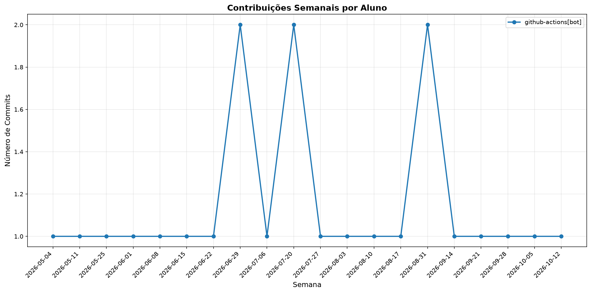

# 📊 Relatório de Contribuições do Projeto

**Última atualização:** 19/10/2026 03:02

---

## 📈 Resumo Geral de Contribuições

| Aluno                 |   Commits |   Linhas+ |   Linhas- |   Arquivos |   Docs Commits |   Docs Arquivos |
|-----------------------|-----------|-----------|-----------|------------|----------------|-----------------|
| Kleber Souza          |         2 |         2 |         2 |          2 |              2 |               1 |
| github-actions[bot]   |        32 |       206 |       117 |          3 |             32 |               1 |
| github-classroom[bot] |         1 |       774 |         0 |         19 |              1 |               3 |

## 📅 Contribuições Semanais (Todo o Semestre)

**2026-10-12**: github-actions[bot]: 1

**2026-10-05**: github-actions[bot]: 1

**2026-09-28**: github-actions[bot]: 1

**2026-09-21**: github-actions[bot]: 1

**2026-09-14**: github-actions[bot]: 1

**2026-08-31**: github-actions[bot]: 2

**2026-08-17**: github-actions[bot]: 1

**2026-08-10**: github-actions[bot]: 1

**2026-08-03**: github-actions[bot]: 1

**2026-07-27**: github-actions[bot]: 1

**2026-07-20**: github-actions[bot]: 2

**2026-07-06**: github-actions[bot]: 1

**2026-06-29**: github-actions[bot]: 2

**2026-06-22**: github-actions[bot]: 1

**2026-06-15**: github-actions[bot]: 1

**2026-06-08**: github-actions[bot]: 1

**2026-06-01**: github-actions[bot]: 1

**2026-05-25**: github-actions[bot]: 1

**2026-05-11**: github-actions[bot]: 1

**2026-05-04**: github-actions[bot]: 1

## 📊 Visualização Gráfica

## ℹ️ Observações

- **Commits**: Número total de commits realizados

- **Linhas+**: Linhas de código adicionadas

- **Linhas-**: Linhas de código removidas

- **Arquivos**: Número de arquivos únicos modificados

- **Docs Commits**: Commits em arquivos de documentação

- **Docs Arquivos**: Arquivos de documentação modificados

---

*Relatório gerado automaticamente via GitHub Actions*
